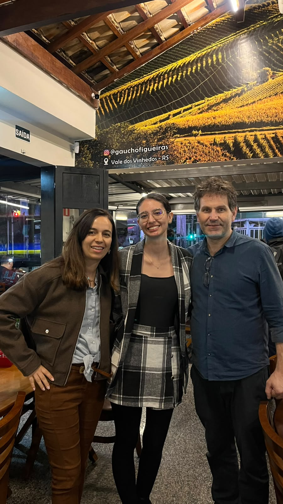

# Gaucho Churrascaria.

Um trabalho universitário sobre um restaurante, para aprimorarmos nossas habilidades de HTML, visando a criação de um site para web. 

## Integrantes do projeto.

**Nome:** Maria Eduarda Arakaki Rodrigues  
**RGM:** 47484900  
**Github:** mariaarakaki

**Nome:** Thayna dos Santos Tavares da Silva  
**RGM:** 47713551  
**Github:** thayna-tavares07

**Nome:** Vitória Lorena Freire Camargo  
**RGM:** 46874283  
**Github:** vitoria-camargo1109

**Nome:** Yasmin da Silva Pinheiro  
**RGM:** 49842013  
**Github:** Miih08  

## Funcionalidades.

- **Página inicial** com botões para as demais páginas 
- **Carta de vinhos**  organizado por categorias, preços e descrições 
- **Cardápio digital** organizado por categorias, preços e descrições 
- **Delivery** para fazer o pedido online 
- **Depoimentos de clientes** com avaliações reais 
- **Fale conosco** informações de contato 
- **Nossa unidade** com mapa incorporado e horário de funcionamento 
- **Quem somos** descrição sobre o restaurante 
- **Sistema de reservas** via formulário 
- **Trabalhe conosco** informações de contato 

## Tecnologias.

- HTML5
- CSS3
- JavaScript

## Link do website hospedado.

- https://vitoria-camargo1109.github.io/projeto_GauchoChurrascaria/

## Indicação da validação no W3C de todas as páginas.

## Introdução apresentando a organização escolhida.

Realizamos o desenvolvimento de um site para um restaurante, com o foco na reformulação do site original. Para a organização do trabalho, optamos por atribuir à aluna Vitória Lorena Freire Camargo a responsabilidade pela padronização e pelo index das páginas, garantindo o mesmo cabeçalho e rodapé em todas elas. Ela também programou as páginas “página inicial”, “fale conosco” e “delivery”. As páginas ‘cardápio digital’ e ‘carta de vinhos’ ficaram sob responsabilidade da aluna Yasmin da Silva Pinheiro, que converteu o cardápio antigo, em PDF, para texto, com um design melhorado. Além disso, a aluna Thayna dos Santos Tavares da Silva realizou a programação das páginas "depoimentos", "trabalhe conosco" e "reservas" que foram adições ao site do cliente, possibilitando que interessados no estabelecimento tenham acesso à essas informações mais fácil. Por fim, a aluna Maria Eduarda Arakaki Rodrigues ficou responsável por programar as páginas ‘nossa unidade’ e ‘quem somos’, com informações adicionais para melhor apresentar o estabelecimento.

## Relato e comprovação do contato.

A aluna Maria Eduarda Arakaki Rodrigues realizou o contato com o responsável e sua esposa, ambos donos do negócio, para pedir a autorização. O encontro ocorreu de maneira positiva, com o cliente muito interessado na proposta, autorizando o uso das imagens e do nome do estabelecimento, pediu que fosse inspirado no site que ele já possuia, oferecemos páginas adicionais como os depoimentos, fale conosco, nossa unidade e trabalhe conosco. O cliente demonstrou agrado ao falarmos das adições, desde então entramos em contato para batermos informações e dar atualizações sobre o progresso.  
Número do dono: (13) 99667-6016 (Jefferson Tomasi)

## Desenvolvimento do site.

- Inspiração

Usamos principalmente de inspiração os sites dos restaurantes Hawksmoor UK (https://thehawksmoor.com/), Hawksmoor USA (https://thehawksmoor.com/us/) e Hawksmoor Ireland (https://www.hawksmoor.ie/) para a estrutura da página de início, que foi a inspiração para as demais páginas. Adotamos o estilo de animação, a tipografia similar e os botões que levam o usuário a ver mais sobre a página, como o botão "ver carta" na carta de vinhos. Gostamos da estrutura do site, da forma que eles usam as imagens e os textos para dar uma breve descrição de uma próxima página, porém não gostamos que o site é muito parado, por isso no nosso site adicionamos uma animação para conforme o usuário desce a tela, os textos e as imagens vão aparecendo com um efeito de Fade in. Segue uma parte do site que nos inspiramos:

- Paleta de cores e Tipografia

Fizemos uma pesquisa de teoria das cores, como o site se trata de um estabelecimento de alimentação, decidimos que as cores vermelho e amarelo seriam as mais adequadas, pois remetem à fome e estimulam o apetite, e também são as cores da logo do restaurante, então achamos que seria interessante manter as cores da logo na estética visual do site. Porém, também testamos as cores dourada (#BF8D50, cor de destaque), marrom (#732C12, cor de apoio) e verde (como as cores #14211B, para detalhes, e #19261F, outra opção de detalhes, para fundos escuros e fundos escuros alternativos, como os cards), porém foram descartadas pois achamos que as cores não combinavam com a logo, e acabava tirando a estética que queríamos para o site. Com a fonte "Oswald, Parisienne e Great Vibes", para banners e títulos, a "Cormorant Garamond" para texto de leitura e a "Montserrat" para a interface. No final, optamos por usar as cores vermelho (#D90718, cor destaque), amarelo (#F2BC1B, cor de apoio) e marrom escuro (#261D1A, para cor de fundo dos cards) e as fontes Parisienne, Great Vibes, Oswald, Montserrat, Cormorant Garamond.

Teste:

Produto final:

- Elementos

Inicialmente, consideramos deixar os botões como "ver mais" com cantos mais arredondados, pois cria uma interface mais amigável, suave e humanizada. Porém, optamos por deixar com um aspecto mais retangular, para trazer uma diferenciação visual e para transmitir uma imagem de modernidade e sofisticação. 

Teste:

Produto final:

## Uso da IA

Utilizamos a IA para nos auxiliar a resolver problemas simples, ensinar a lógica, fazer revisão do site, aprendizado e principalmente analisar os requisitos desejados. Nosso grupo optou por utilizar o Claude como IA para nos ajudar a desenvolver o site e tirar dúvidas. Escolhemos usar a IA somente nestas tarefas pois queríamos nos desafiar a aprender a estrutura do Front-end na prática, não dependendo somente da inteligência artificial para fazer nosso trabalho, mas fomos testando e aprendendo as estruturas básicas, usando apenas como apoio para ser um site que cobre todos os requisitos e para ser um código organizado. Para a verificação das respostas, frequentemente mostrávamos nosso progresso ao professor, e pedíamos feedback e análise para garantir que estava tudo nos conformes, também conversamos em grupo para validar se aquilo que a IA sugeriu era viável ou era melhor fazer de outra forma, como por exemplo, para requisitos, onde a IA pedia para alterarmos partes do HTML que já haviam sido avaliados e aprovados na entrega 1, onde optamos por deixar do jeito que estava, que já estava ótimo e funcionando com perfeição.

## Como seria um processo por IA

Se o site fosse desenvolvido com apoio de IA, o processo seria:
1. Briefing: passar para a IA o que levantamos com o cliente (páginas desejadas, identidade do restaurante, cores da logo, o site original).
2. Prompts por página: pedir uma página de cada vez (ex.: "crie o HTML5 semântico da página de reservas com formulário, usando estas cores e fontes"), para manter o mesmo cabeçalho e rodapé em todas.
3. Revisão e ajustes: testar no navegador, validar no W3C, comparar com os sites de referência e pedir correções com prompts mais específicos.
4. Decisões humanas: a escolha de paleta, o formato dos botões e o conteúdo continuariam sendo do grupo e do cliente.

Comparado ao que fizemos, a IA aceleraria a escrita do código, mas o aprendizado de estrutura seria menor e o resultado exigiria revisão cuidadosa, pois a IA pode
errar ou sugerir mudanças desnecessárias, como aconteceu com o HTML aprovado na entrega 1.

## Estrutura e conteúdo

- Decisões de estrutura.

A página inicial foi montada a partir dos sites de referência e serviu de modelo para as demais, com o mesmo cabeçalho, rodapé e navegação em todas as páginas, para o usuário se orientar facilmente. Mantivemos as páginas que já existiam no site original (cardápio, carta de vinhos, delivery) e acrescentamos páginas novas (depoimentos, fale conosco, nossa unidade, reservas e trabalhe conosco) para facilitar o acesso às informações do restaurante. O site foi publicado com GitHub Pages e todas as páginas foram validadas no W3C.

- Conteúdo levantado.

O cardápio original era um PDF e foi convertido para texto, organizado por categorias, preços e descrições. Os textos de "Quem somos"
e "Nossa unidade", o horário de funcionamento e o mapa incorporado foram levantados com o cliente, o site original e o Google Maps. As imagens foram usadas com autorização do dono do restaurante.

- Desafios técnicos.

- Manter a padronização visual entre páginas feitas por pessoas diferentes.
- Converter o cardápio em PDF para HTML sem perder a organização.
- Corrigir os erros apontados pelo validador do W3C.
- Deixar o layout responsivo.
- Usar as branch e os commits do Vscode.

## Conclusão com a reflexão do grupo sobre os aprendizados da etapa

Ao longo do desenvolvimento deste projeto, pudemos colocar em prática os conceitos de HTML estudados em sala de aula, aplicando-os em um contexto real: a criação de um site funcional para um cliente de verdade. Essa experiência trouxe desafios que vão além do código, como entender as necessidades do cliente, manter a padronização visual entre as páginas e organizar o trabalho em equipe de forma que cada integrante pudesse contribuir de acordo com suas responsabilidades.

Um dos principais aprendizados foi a importância da estrutura semântica do HTML para garantir acessibilidade e organização do conteúdo, além de perceber como pequenos detalhes — como links funcionais, atributos corretos e validação do código — fazem diferença na qualidade final do produto. O contato direto com o cliente também foi enriquecedor, pois nos mostrou como alinhar expectativas e traduzir pedidos informais em funcionalidades concretas no site.

Como grupo, sentimos que a divisão de tarefas por página facilitou o desenvolvimento, mas também reforçou a necessidade de comunicação constante para manter a coerência entre as partes construídas por cada integrante. Encerramos esta etapa com mais confiança para lidar com projetos de front-end e com uma base mais sólida para os próximos desafios da disciplina.
